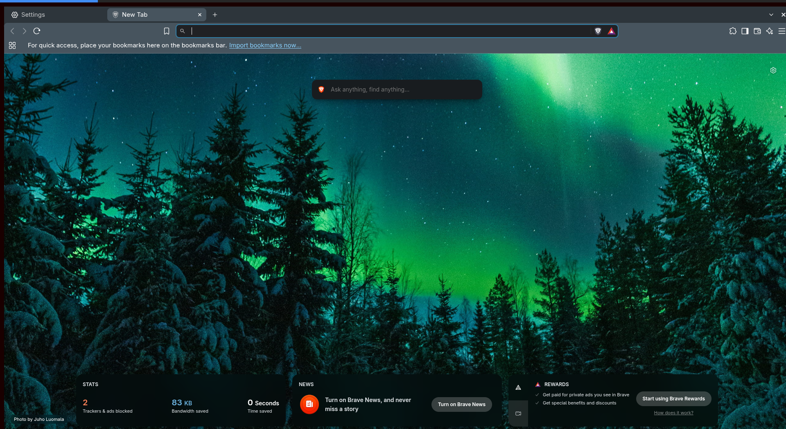

# LTMI
Lock The Monk In

## Showcase


## Description
LTMI is a minimal, non-standalone Wayland compositor for Linux that helps you stay productive. It opens as a single window inside your existing desktop session, runs one app fullscreen inside it, and locks you in with that app until a timer runs out.

While you're locked in:
- A thin bar along the top of the window fills up blue as the timer runs and turns green when you're done.
- The timer only runs while the LTMI window is focused, so time spent in other windows doesn't count.
- Closing the LTMI window is ignored.
- If the app quits (close button, Ctrl+Q, closing the last tab), LTMI starts it again. With the Chromium preset your tabs come back too.

Once the timer is done, closing the window or the app ends the session normally. It isn't a prison: you can still kill LTMI from a terminal. It just turns quitting into a deliberate decision instead of a reflex.

## How it's built
LTMI is written in Rust on top of [Smithay](https://github.com/Smithay/smithay), a library for building Wayland compositors. It uses Smithay's winit backend, which is why it runs as a window inside another compositor (Hyprland, Sway, GNOME, KDE...) instead of taking over the whole screen. Command-line flags are parsed with [clap](https://github.com/clap-rs/clap).

Some details worth knowing:
- **Wayland and X11 apps.** Wayland apps connect straight to LTMI's own socket. If Xwayland is installed, LTMI also starts it and acts as its window manager, so X11 apps work too.
- **GPU rendering.** LTMI supports the `linux-dmabuf` protocol, so apps render on the GPU instead of falling back to software rendering.
- **Offline mode.** `--offline` starts the app in a new user and network namespace that only has loopback. The app can't reach the internet, but localhost, display, D-Bus and audio still work. If your system doesn't allow unprivileged user namespaces, LTMI refuses to start rather than quietly running the app online.

## Installation
### Prebuilt binary
Download the latest `x86_64` Linux build from the [releases page](https://github.com/danielhejduk/LTMI/releases), unpack it and run `./ltmi`.

### Build from source
You need a recent Rust toolchain (edition 2024, so Rust 1.85 or newer) and the `libxkbcommon` development headers (`libxkbcommon-dev` on Debian/Ubuntu, `libxkbcommon` on Arch). Xwayland is optional and only needed for X11 apps.

```sh
git clone https://github.com/danielhejduk/LTMI.git
cd LTMI
cargo build --release
# the binary ends up in target/release/ltmi
```

To run the tests:

```sh
cargo test
```

## Usage
There are no configuration files, only flags. Run LTMI from inside a Wayland session and give it the program to launch:

```sh
# Lock yourself into Brave for the default 30 minutes
./ltmi brave

# Two hours of focused work in Chromium, without internet access
./ltmi -t 2h -o chromium

# Any other app, launched without the Chromium-specific arguments
./ltmi -p blank -t 45m foot
```

The default `chromium` preset launches the browser with native Wayland enabled and a separate profile stored in `~/.local/share/ltmi/chromium-profile`, so your normal browser session (and its distractions) stay out of it.

### Flags
| Flag | Description | Default |
| --- | --- | --- |
| `-t`, `--time` | How long you're locked in, e.g. `30m`, `90m`, `2h` | `30m` |
| `-p`, `--preset` | Arguments to launch the app with: `chromium` or `blank` | `chromium` |
| `-o`, `--offline` | Cut the app off from the network | off |

Set `RUST_LOG=debug` to see what LTMI is doing, like when the timer pauses and resumes.

## Why did I make this?
I have a hard time concentrating on my work, so I wanted to make procrastinating hard for myself. Website blockers are easy to turn off and a timer on my phone is easy to ignore. LTMI puts the one thing I should be doing in front of me and makes leaving it early take real effort.

## License
GPL-3.0, see [LICENSE](LICENSE).
